

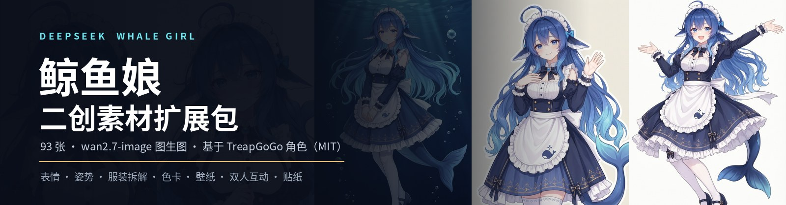

# 鲸鱼娘二创素材扩展包

**93 张** · **13 个分类** · **长边最高 2048** · **AI 生成（wan2.7-image 图生图）** · 角色参考 [TreapGoGo/deepseek-whale-girl](https://github.com/TreapGoGo/deepseek-whale-girl)（MIT）

> 基于原仓库参考图做的**细节扩展素材**，补足表情、姿势、服装拆解、色卡、鲸尾结构、横版壁纸与双人互动这些原仓库没有覆盖的方向。逐张的 prompt、参考图编号与尺寸见 [`manifest.csv`](manifest.csv)。

---

## 精选 12 张

<table>
<tr>
<td align="center" width="24%"> 成熟·侧面全身</td>
<td align="center" width="24%"> Q版·正面全身</td>
<td align="center" width="24%"> Q版·3/4侧身全身</td>
<td align="center" width="24%"> 成熟·表情大笑</td>
</tr>
<tr>
<td align="center" width="24%"> 成熟·表情害羞</td>
<td align="center" width="24%"> Q版·表情惊讶</td>
<td align="center" width="24%"><a href="share-1600/C29.jpg">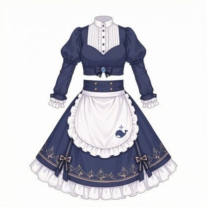</a> 成熟·服装层次剖面</td>
<td align="center" width="24%"><a href="share-1600/C31.jpg">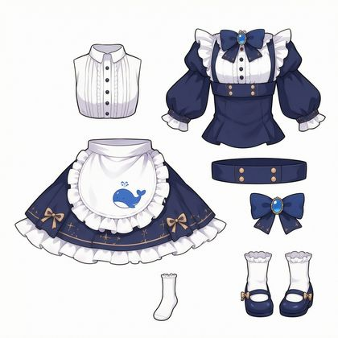</a> Q版·服装平铺拆解图</td>
</tr>
<tr>
<td align="center" width="24%"><a href="share-1600/C34.jpg">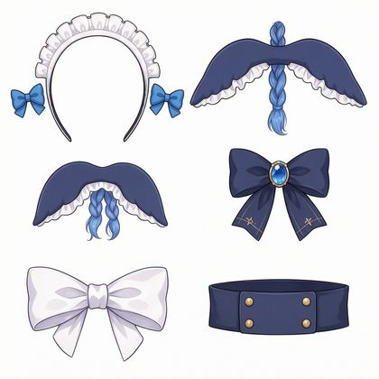</a> 成熟·配饰大全</td>
<td align="center" width="24%"><a href="share-1600/C37.jpg">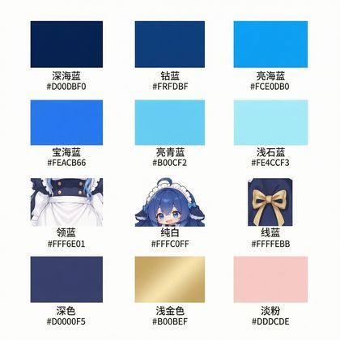</a> 共享·主色卡（带色号）</td>
<td align="center" width="24%"> 成熟·办公桌场景壁纸</td>
<td align="center" width="24%"> 双人·并排合影</td>
</tr>
</table>

> 点任意一张打开 1600 长边版本；需要原分辨率 PNG 请到 [`full-res/`](full-res)。

---

## 全部 93 张

按分类折叠，点标题展开。缩略图点击后打开长边 1600 的分享版。

<b>01 · 单视图立绘（8 张）</b>　正面 · 侧面 · 背面 · 3/4 侧身，Q 版与成熟各一套

<table>
<tr>
<td align="center" width="19%"> 成熟·侧面全身</td>
<td align="center" width="19%"><a href="share-1600/C02.jpg">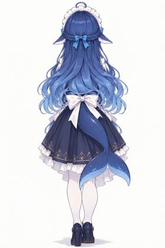</a> 成熟·背面全身</td>
<td align="center" width="19%"> 成熟·3/4侧身全身</td>
<td align="center" width="19%"> Q版·正面全身</td>
<td align="center" width="19%"> Q版·侧面全身</td>
</tr>
<tr>
<td align="center" width="19%"><a href="share-1600/C06.jpg">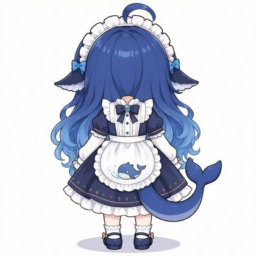</a> Q版·背面全身</td>
<td align="center" width="19%"> Q版·3/4侧身全身</td>
<td align="center" width="19%"> 成熟·正面全身高清重制</td>
</tr>
</table>

<b>02 · 表情集（19 张）</b>　大笑 · 微笑 · 害羞 · 不满 · 惊讶 · 眨眼 · 困倦 · 感动哭 · 得意 · 吃醋

<table>
<tr>
<td align="center" width="19%"> 成熟·表情大笑</td>
<td align="center" width="19%"> 成熟·表情微笑</td>
<td align="center" width="19%"> 成熟·表情害羞</td>
<td align="center" width="19%"> 成熟·表情不满</td>
<td align="center" width="19%"> 成熟·表情惊讶</td>
</tr>
<tr>
<td align="center" width="19%"> 成熟·表情眨眼</td>
<td align="center" width="19%"> Q版·表情大笑</td>
<td align="center" width="19%"> Q版·表情微笑</td>
<td align="center" width="19%"> Q版·表情不满</td>
<td align="center" width="19%"> Q版·表情惊讶</td>
</tr>
<tr>
<td align="center" width="19%"> Q版·表情眨眼</td>
<td align="center" width="19%"> 成熟·表情困倦</td>
<td align="center" width="19%"> 成熟·表情感动哭</td>
<td align="center" width="19%"> 成熟·表情得意</td>
<td align="center" width="19%"> 成熟·表情吃醋</td>
</tr>
<tr>
<td align="center" width="19%"> Q版·表情困倦</td>
<td align="center" width="19%"> Q版·表情感动哭</td>
<td align="center" width="19%"> Q版·表情得意</td>
<td align="center" width="19%"> Q版·表情吃醋</td>
</tr>
</table>

<b>03 · 姿势与动作（13 张）</b>　叉腰 · 挥手 · 合十 · 抱膝 · 奔跑 · 跳跃

<table>
<tr>
<td align="center" width="19%"> 成熟·姿势叉腰站姿</td>
<td align="center" width="19%"><a href="share-1600/C24.jpg">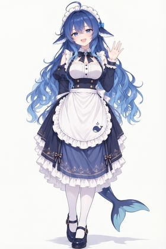</a> 成熟·姿势挥手打招呼</td>
<td align="center" width="19%"> 成熟·姿势双手合十</td>
<td align="center" width="19%"> 成熟·坐姿抱膝（收紧版）</td>
<td align="center" width="19%"> 成熟·坐姿抱膝</td>
</tr>
<tr>
<td align="center" width="19%"> 成熟·姿势奔跑</td>
<td align="center" width="19%"> 成熟·姿势跳跃</td>
<td align="center" width="19%"> Q版·姿势叉腰站姿</td>
<td align="center" width="19%"> Q版·姿势挥手打招呼</td>
<td align="center" width="19%"> Q版·姿势双手合十</td>
</tr>
<tr>
<td align="center" width="19%"> Q版·姿势坐姿抱膝</td>
<td align="center" width="19%"> Q版·姿势奔跑</td>
<td align="center" width="19%"> Q版·姿势跳跃</td>
</tr>
</table>

<b>04 · 胸像与半身（4 张）</b>　头像 / 半身立绘，适合做头像与表情包底图

<table>
<tr>
<td align="center" width="19%"> Q版·害羞脸红胸像</td>
<td align="center" width="19%"> 成熟·开心大笑胸像</td>
<td align="center" width="19%"> 成熟·正面半身立绘</td>
<td align="center" width="19%"> Q版·正面半身立绘</td>
</tr>
</table>

<b>05 · 服装与配饰拆解（9 张）</b>　平铺拆解 · 层次剖面 · 装饰细节总览 · 配饰大全

<table>
<tr>
<td align="center" width="19%"> 成熟·服装层次剖面</td>
<td align="center" width="19%"><a href="share-1600/C30.jpg">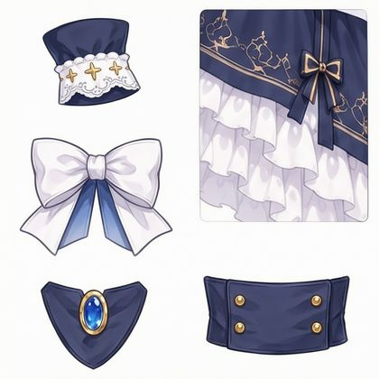</a> 成熟·装饰细节总览</td>
<td align="center" width="19%"> Q版·服装平铺拆解图</td>
<td align="center" width="19%"><a href="share-1600/C32.jpg">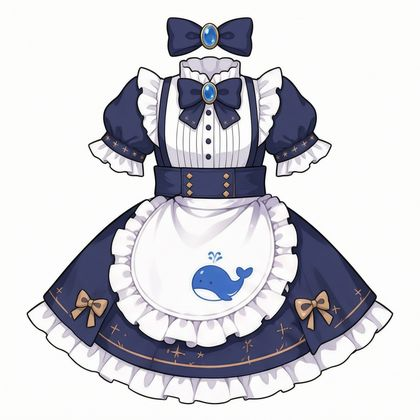</a> Q版·服装层次剖面</td>
<td align="center" width="19%"><a href="share-1600/C33.jpg">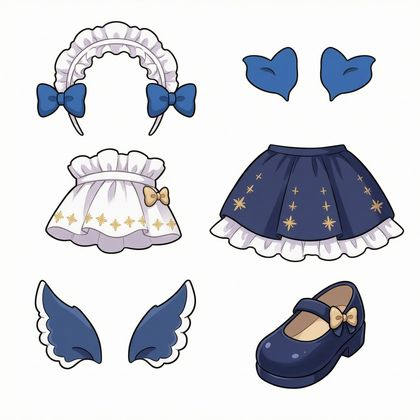</a> Q版·装饰细节总览</td>
</tr>
<tr>
<td align="center" width="19%"> 成熟·配饰大全</td>
<td align="center" width="19%"><a href="share-1600/C35.jpg">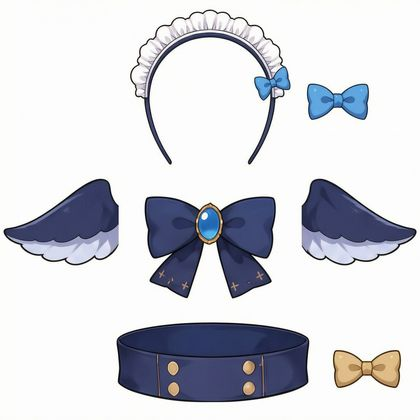</a> Q版·配饰大全</td>
<td align="center" width="19%"><a href="share-1600/P5.jpg">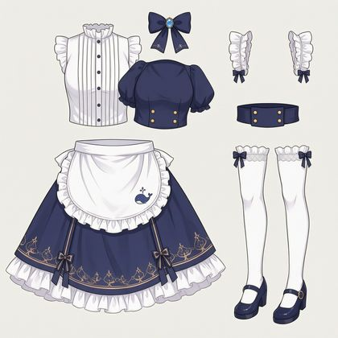</a> 成熟·服装平铺拆解图</td>
<td align="center" width="19%"><a href="share-1600/P6.jpg">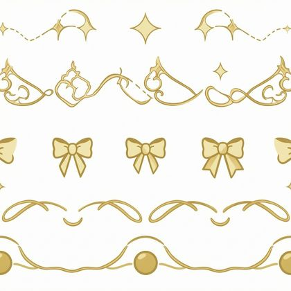</a> 共享·金色装饰纹样总览</td>
</tr>
</table>

<b>06 · 色卡与纹样（3 张）</b>　主色卡（含色号）· 头发渐变与眼睛拆解 · 小蓝鲸与水花图案

<table>
<tr>
<td align="center" width="19%"> 共享·主色卡（带色号）</td>
<td align="center" width="19%"><a href="share-1600/C38.jpg">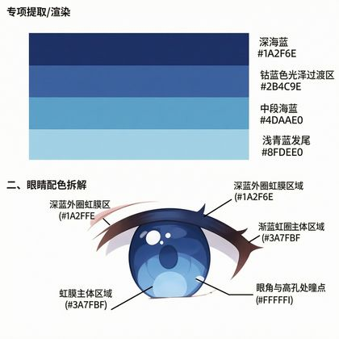</a> 共享·头发渐变与眼睛拆解</td>
<td align="center" width="19%"><a href="share-1600/C36.jpg">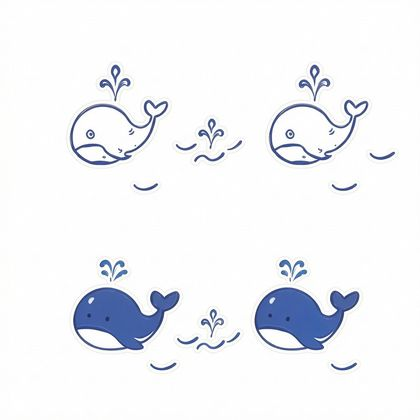</a> 共享·小蓝鲸与水花图案</td>
</tr>
</table>

<b>07 · 鲸鱼特征结构（5 张）</b>　鲸尾 · 鲸鳍耳的多角度结构说明

<table>
<tr>
<td align="center" width="19%"><a href="share-1600/C39.jpg">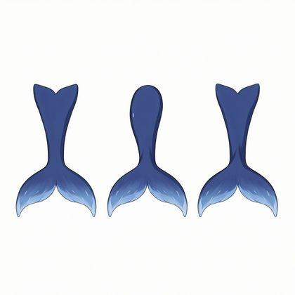</a> 成熟·鲸尾结构多角度（收紧版）</td>
<td align="center" width="19%"><a href="share-1600/C40.jpg">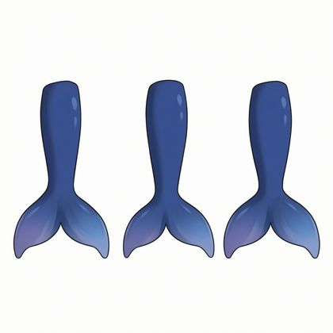</a> Q版·鲸尾结构多角度</td>
<td align="center" width="19%"><a href="share-1600/C41.jpg">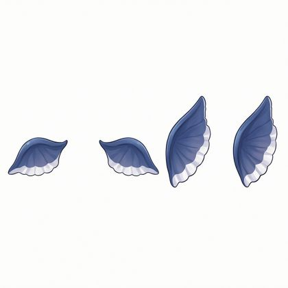</a> 成熟·鲸鳍耳结构多角度</td>
<td align="center" width="19%"><a href="share-1600/C42.jpg">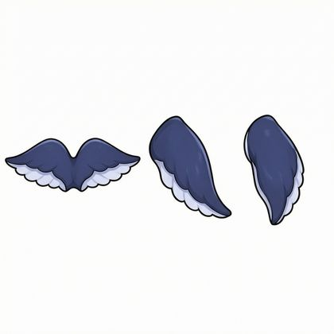</a> Q版·鲸鳍耳结构多角度</td>
<td align="center" width="19%"><a href="share-1600/P7.jpg">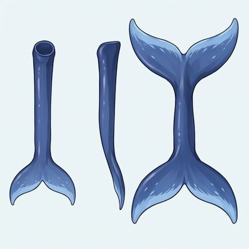</a> 成熟·鲸尾结构多角度</td>
</tr>
</table>

<b>08 · 线稿与平涂（4 张）</b>　纯线稿 · 平涂色块版，可直接用于上色练习或分色

<table>
<tr>
<td align="center" width="19%"><a href="share-1600/C44.jpg">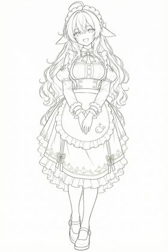</a> 成熟·纯线稿</td>
<td align="center" width="19%"> Q版·平涂色块版</td>
<td align="center" width="19%"> 成熟·平涂色块版</td>
<td align="center" width="19%"><a href="share-1600/P8.jpg">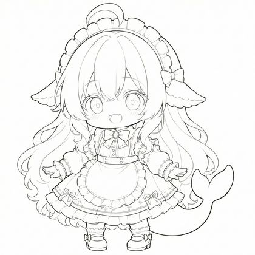</a> Q版·纯线稿</td>
</tr>
</table>

<b>09 · 比例对照（2 张）</b>　Q 版 ↔ 成熟并排对照 · 头身比结构图解

<table>
<tr>
<td align="center" width="19%"><a href="share-1600/C46.jpg">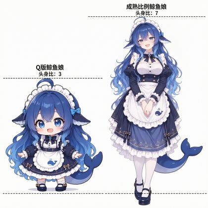</a> 共享·Q版与成熟并排比例对照</td>
<td align="center" width="19%"><a href="share-1600/C47.jpg">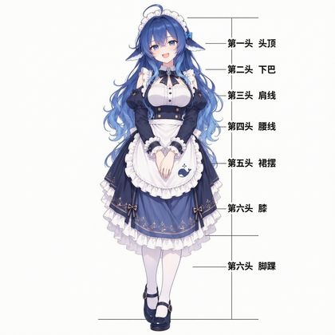</a> 共享·头身比结构图解</td>
</tr>
</table>

<b>10 · 表情贴纸（6 张）</b>　带白色描边，可直接抠图当聊天贴纸

<table>
<tr>
<td align="center" width="19%"> Q版·贴纸比心</td>
<td align="center" width="19%"> Q版·贴纸竖大拇指点赞</td>
<td align="center" width="19%"> Q版·贴纸疑惑歪头</td>
<td align="center" width="19%"><a href="share-1600/C53.jpg">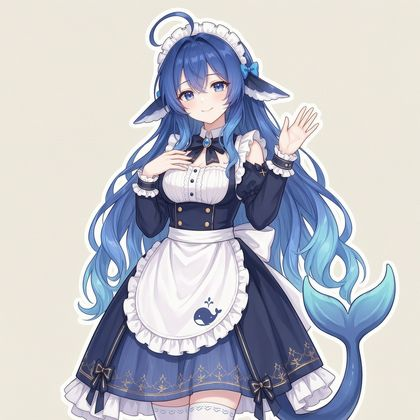</a> 成熟·贴纸微笑挥手</td>
<td align="center" width="19%"> 成熟·贴纸眨眼比心</td>
</tr>
<tr>
<td align="center" width="19%"> 成熟·贴纸无奈扶额</td>
</tr>
</table>

<b>11 · 氛围场景（8 张）</b>　深海气泡 · 星空夜 · 雨天窗边 · 办公桌前

<table>
<tr>
<td align="center" width="19%"> 成熟·氛围深海气泡</td>
<td align="center" width="19%"> 成熟·氛围星空夜</td>
<td align="center" width="19%"> 成熟·氛围雨天窗边</td>
<td align="center" width="19%"> 成熟·氛围办公桌前</td>
<td align="center" width="19%"> Q版·氛围深海气泡</td>
</tr>
<tr>
<td align="center" width="19%"> Q版·氛围星空夜</td>
<td align="center" width="19%"> Q版·氛围雨天窗边</td>
<td align="center" width="19%"> Q版·氛围办公桌前</td>
</tr>
</table>

<b>12 · 横版壁纸（8 张）</b>　16:9 与 21:9，含白底、深海、星空、办公桌场景，含双人版

<table>
<tr>
<td align="center" width="19%"> 成熟·白底标准壁纸</td>
<td align="center" width="19%"> 成熟·星空宽幅壁纸</td>
<td align="center" width="19%"> 成熟·办公桌场景壁纸</td>
<td align="center" width="19%"> Q版·白底标准壁纸</td>
<td align="center" width="19%"> Q版·深海宽幅壁纸</td>
</tr>
<tr>
<td align="center" width="19%"> Q版·办公桌场景壁纸</td>
<td align="center" width="19%"> 双人·白底标准壁纸</td>
<td align="center" width="19%"> 双人·深海宽幅壁纸</td>
</tr>
</table>

<b>13 · 双人互动（4 张）</b>　并排合影 · 抱起 · 背对背 · 一起办公

<table>
<tr>
<td align="center" width="19%"> 双人·并排合影</td>
<td align="center" width="19%"><a href="share-1600/C87.jpg">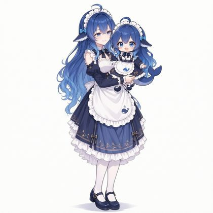</a> 双人·成熟抱起Q版</td>
<td align="center" width="19%"> 双人·背对背站立</td>
<td align="center" width="19%"> 双人·一起在办公桌前</td>
</tr>
</table>

---

## 目录结构

| 目录 | 内容 | 体积 | 用途 |
|---|---|---|---|
| [`thumbs/`](thumbs) | 93 张长边 420 缩略图（JPEG） | 2.3 MB | **本页展示用**，不单独下载 |
| [`share-1600/`](share-1600) | 全部 93 张，长边 1600（JPEG） | 25.9 MB | 日常分享、投稿预览、聊天发送 |
| [`full-res/`](full-res) | 全部 93 张全分辨率（PNG） | ≈190 MB | 抠图、二次编辑、印刷级使用 |
| [`featured/`](featured) | 精选 12 张（长边 2048 JPEG） | 2.8 MB | 宣传图、投稿封面 |
| [`sheets/`](sheets) | 4 张拼版总览（JPEG） | 6.7 MB | **一眼看全**，可直接拖进 issue 表单 |
| [`manifest.csv`](manifest.csv) | 93 行：变体号 / 内容 / 尺寸 / 文件名 / 参考图 / 完整 prompt | 270 KB | 检索与复现 |
| [`assets/`](assets) | 本页 banner 与社交分享图 | 0.2 MB | — |

### 拼版总览

<a href="sheets/01-all-93.jpg">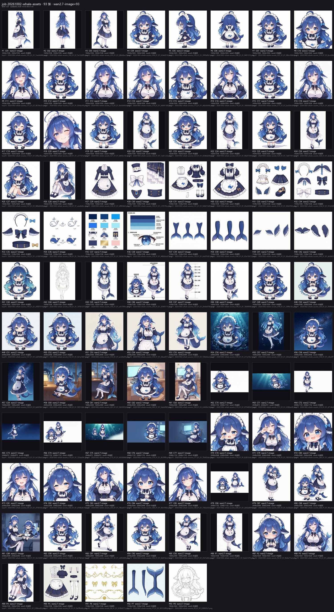</a>

点击查看原尺寸（另有 [`02-core-47`](sheets/02-core-47.jpg) / [`03-highres-14`](sheets/03-highres-14.jpg) / [`04-final-24`](sheets/04-final-24.jpg) 三个分卷拼版）

---

## 素材构成

| # | 分类 | 张数 | 内容 |
|---|---|---|---|
| 01 | 单视图立绘 | 8 | 正面 · 侧面 · 背面 · 3/4 侧身，Q 版与成熟各一套 |
| 02 | 表情集 | 19 | 大笑 · 微笑 · 害羞 · 不满 · 惊讶 · 眨眼 · 困倦 · 感动哭 · 得意 · 吃醋 |
| 03 | 姿势与动作 | 13 | 叉腰 · 挥手 · 合十 · 抱膝 · 奔跑 · 跳跃 |
| 04 | 胸像与半身 | 4 | 头像 / 半身立绘，适合做头像与表情包底图 |
| 05 | 服装与配饰拆解 | 9 | 平铺拆解 · 层次剖面 · 装饰细节总览 · 配饰大全 |
| 06 | 色卡与纹样 | 3 | 主色卡（含色号）· 头发渐变与眼睛拆解 · 小蓝鲸与水花图案 |
| 07 | 鲸鱼特征结构 | 5 | 鲸尾 · 鲸鳍耳的多角度结构说明 |
| 08 | 线稿与平涂 | 4 | 纯线稿 · 平涂色块版，可直接用于上色练习或分色 |
| 09 | 比例对照 | 2 | Q 版 ↔ 成熟并排对照 · 头身比结构图解 |
| 10 | 表情贴纸 | 6 | 带白色描边，可直接抠图当聊天贴纸 |
| 11 | 氛围场景 | 8 | 深海气泡 · 星空夜 · 雨天窗边 · 办公桌前 |
| 12 | 横版壁纸 | 8 | 16:9 与 21:9，含白底、深海、星空、办公桌场景，含双人版 |
| 13 | 双人互动 | 4 | 并排合影 · 抱起 · 背对背 · 一起办公 |
| | **合计** | **93** | |

分辨率：后 38 张为高分辨率（2048×2048 / 1600×2400 / 2048×1152 / 2048×872），前 55 张为 1024–1536 档。全部为 PNG 不透明底、纯白或浅色背景，便于抠图。

---

## 授权与署名

- 角色参考来自 **[TreapGoGo/deepseek-whale-girl](https://github.com/TreapGoGo/deepseek-whale-girl)**，**MIT License**（Copyright (c) 2026 TreapGoGo）。MIT 要求保留版权声明，建议在使用/再分发时署名：
  > 角色参考：TreapGoGo/deepseek-whale-girl（MIT License）
- 本批素材为 **AI 生成（wan2.7-image 图生图）**，投稿时请如实选择「使用了生成式 AI 或 AI 辅助」。
- 该站声明「不设定标准人设、欢迎变体」，因此本批与母图存在风格/细节差异是预期的，不是错误。

---

## 复现

每张图在源工作区的 `jobs/<jobId>/out/` 下都有同名 `.json` sidecar，含完整 prompt、模型、尺寸、参考图编号与 key 序号；按 [`manifest.csv`](manifest.csv) 可逐张复现或再编辑。`manifest.csv` 的 `prompt` 列已包含可直接复用的完整提示词。

